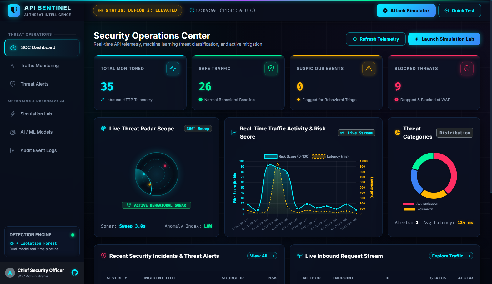
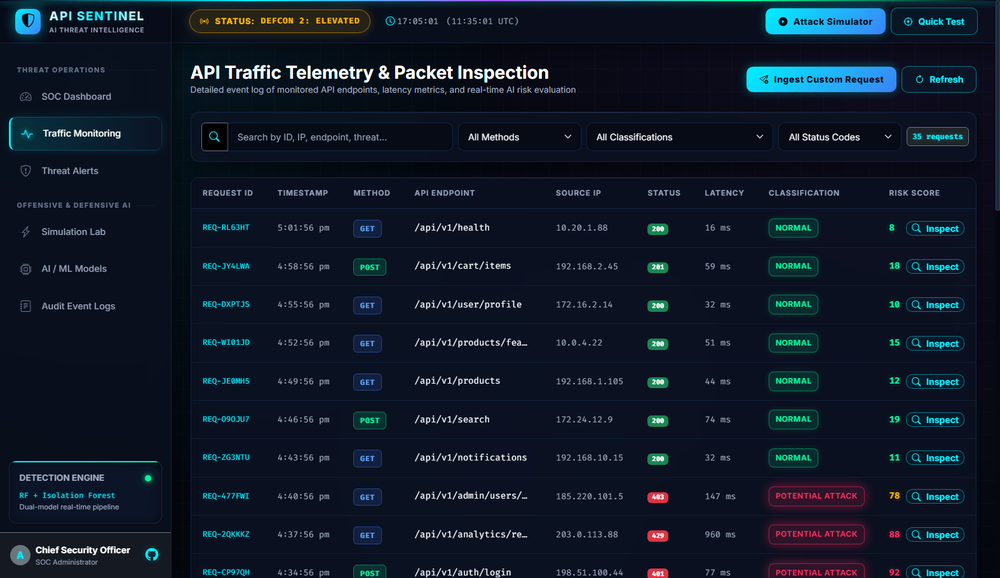
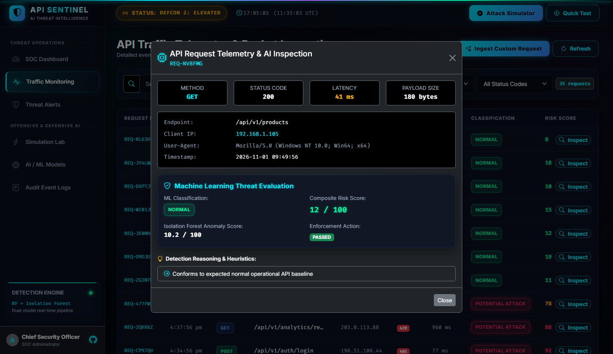
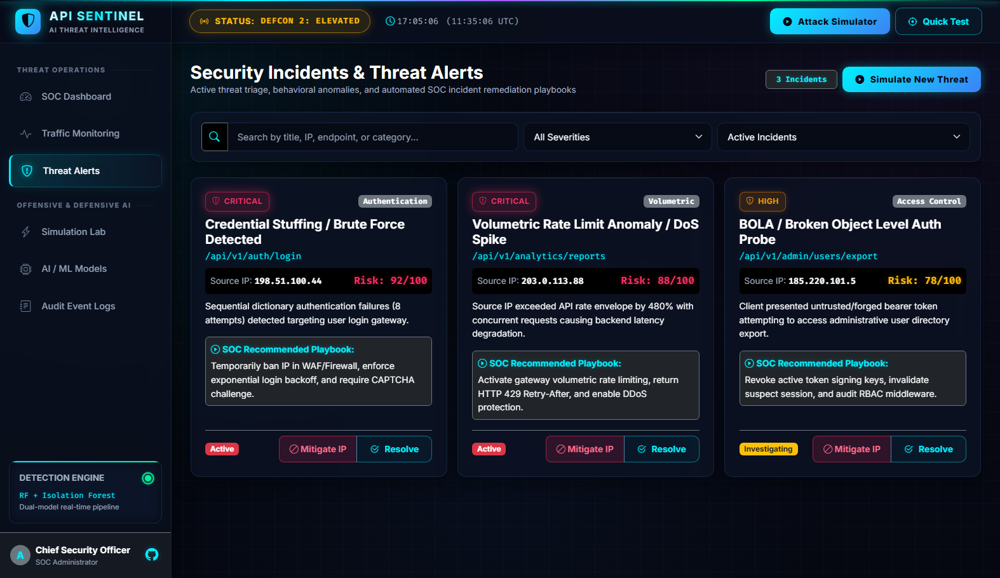
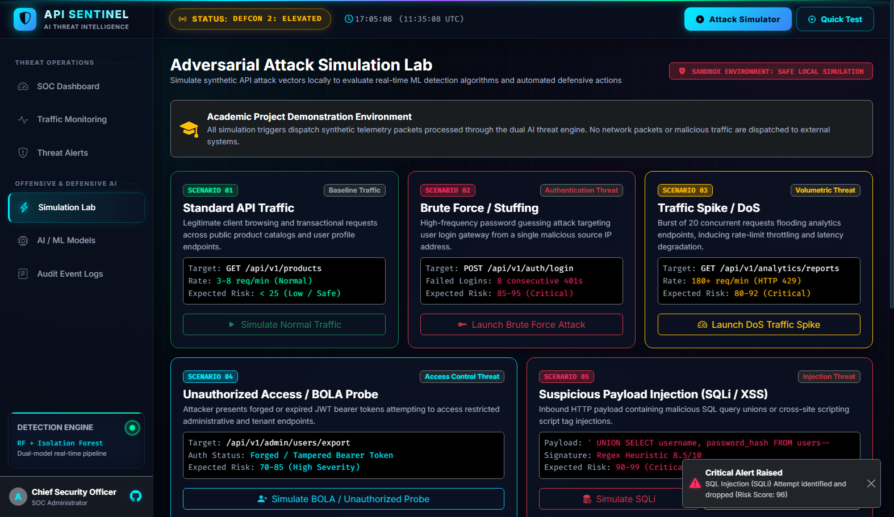
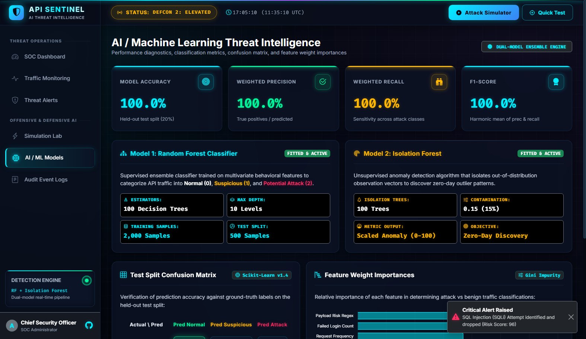
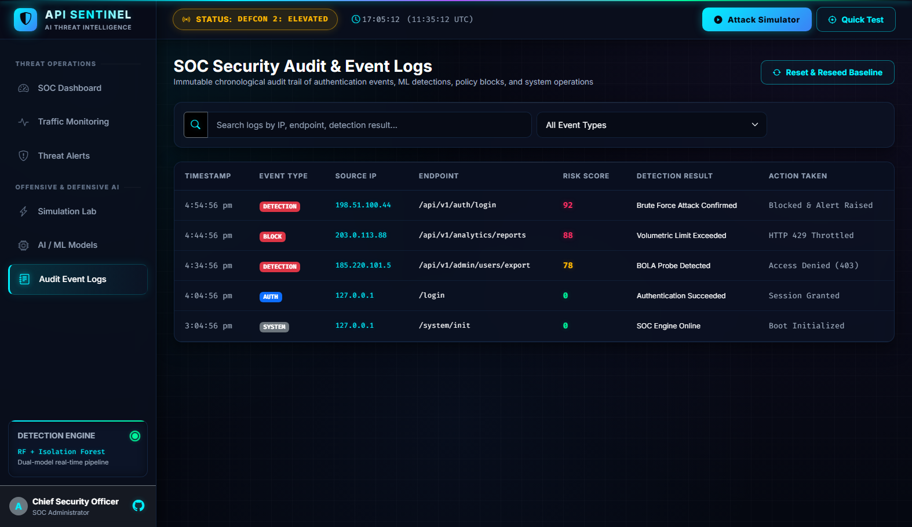

# 🛡️ API SENTINEL — SOC Platform Operations Guide & Walkthrough

> 📄 **Download High-Definition PDF Manual:** [API_SENTINEL_SOC_WALKTHROUGH.pdf](API_SENTINEL_SOC_WALKTHROUGH.pdf)

Welcome to the comprehensive technical documentation and visual walkthrough for **API SENTINEL – AI-Powered API Security and Intelligent Threat Detection Platform**.

This guide details **what is happening across every view and option** of the platform, explaining the underlying AI/ML engines, telemetry streams, visual indicators, and interactive workflows.

---

## 📑 Table of Contents
1. [Platform Architecture & Color System](#1-platform-architecture--color-system)
2. [Option 1: SOC Command Dashboard](#2-option-1-soc-command-dashboard)
3. [Option 2: API Traffic Telemetry & Packet Inspection](#3-option-2-api-traffic-telemetry--packet-inspection)
4. [Option 3: Security Incidents & Threat Alerts Triage](#4-option-3-security-incidents--threat-alerts-triage)
5. [Option 4: Adversarial Attack Simulation Lab](#5-option-4-adversarial-attack-simulation-lab)
6. [Option 5: AI & Machine Learning Intelligence Engine](#6-option-5-ai--machine-learning-intelligence-engine)
7. [Option 6: SOC Audit & Security Event Logs](#7-option-6-soc-audit--security-event-logs)
8. [Summary of Interactive Capabilities](#8-summary-of-interactive-capabilities)

---

## 1. Platform Architecture & Color System

The platform uses a dark cyberpunk Security Operations Center (SOC) visual system optimized for low-latency visual threat triage:

| Color Accent | Hex Code | Purpose & Semantic Meaning |
| :--- | :--- | :--- |
| **Obsidian Base** | `#050811` | Primary background, high-contrast matte dark finish |
| **Glassmorphism Panels** | `rgba(13, 22, 45, 0.75)` | Translucent backdrop blur (`16px`) with neon border styling |
| **Electric Cyan** | `#00f0ff` | Primary active telemetry, healthy system status, traffic spline lines |
| **Radiant Emerald** | `#00f59b` | Verified safe traffic, 200 OK responses, low anomaly scores |
| **Solar Amber** | `#ffb703` | Suspicious behavior, 4xx client errors, medium risk warnings |
| **Crimson Laser** | `#ff2e63` | Critical threats, blocked attacks, WAF drops, high anomaly blips |

---

## 2. Option 1: SOC Command Dashboard

The **SOC Command Dashboard** serves as the central operational hub for security analysts and engineers. It aggregates real-time metrics, active radar scopes, live timeline graphs, and instant incident telemetry.

### What is Happening in This View:
1. **Top Cyber Laser Scanline & Live UTC Clock:**
   - A pulsing cyan laser scanline sweeps continuously across the top header.
   - The top header synchronizes local system time with UTC wall-clock time (`UTC HH:MM:SS`) for standardized forensic correlation.
2. **Four Neon KPI Telemetry Glow Cards:**
   - **Total Inbound Requests (Cyan Glow):** Aggregates total incoming API requests processed across all protected endpoints.
   - **Safe Verified Traffic (Emerald Glow):** Quantifies clean API calls complying with behavioral baseline profiles.
   - **Suspicious Anomalies (Amber Glow):** Highlights borderline traffic (e.g. rate limit bursts, unauthorized probing, invalid parameters).
   - **Blocked Attacks (Crimson Glow):** Displays the total number of malicious requests terminated at the Web Application Firewall (WAF) boundary.
3. **360° Threat Radar Scope HUD:**
   - A circular military-style radar HUD with 3 concentric distance ranges and crosshairs.
   - A glowing 360-degree radial ray sweeps continuously.
   - **Active Threat Blips:** Pulses in real-time. Threats with high anomaly scores are plotted closer to the perimeter with critical red/amber glow.
4. **Real-Time Traffic Activity Spline Chart:**
   - Powered by Chart.js with an electric cyan linear gradient fill.
   - Plots request volume over time (15 telemetry snapshots), illustrating throughput trends and sudden traffic surges.
5. **Threat Category Distribution Doughnut Chart:**
   - Categorizes identified threats into: *Authentication / Credential Stuffing*, *Injection (SQLi/XSS)*, *Rate Limit DoS*, *BOLA / IDOR*, and *Statistical Anomalies*.
6. **Inbound Request & Incident Streams:**
   - Displays the 5 most recent security alerts and the 6 most recent raw API calls with color-coded HTTP method badges (`GET` cyan, `POST` amber, `DELETE` red).

---

## 3. Option 2: API Traffic Telemetry & Packet Inspection

The **Traffic Telemetry** view provides full-spectrum packet-level visibility into every HTTP transaction passing through the API gateway.

### What is Happening in This View:
1. **Telemetry Stream Table:**
   - Logs every transaction with: Request ID (`REQ-XXXXXX`), Timestamp, HTTP Method, API Endpoint, Status Code, Latency (ms), Payload Size, Client IP, AI Classification, and Risk Score.
2. **Interactive Status Filters:**
   - Filter pills (`ALL`, `SAFE (200s)`, `SUSPICIOUS (4xx)`, `BLOCKED (Attacks)`) allow analysts to filter thousands of records instantly.
3. **Dynamic Risk Meter Bars:**
   - Each request has a percentage bar (0–100%) color-coded according to severity:
     - 0–29%: Low risk (Emerald green)
     - 30–69%: Medium risk (Solar amber)
     - 70–100%: Critical risk (Crimson laser red)

### Deep Packet Inspection Modal:
Clicking the **Inspect** button on any transaction opens the forensic inspection modal:

- **Connection Telemetry:** Inspects HTTP Method, Status Code, Latency, Payload Size, Client IP, and User-Agent string.
- **AI Classification Decision:** Shows the Random Forest output (`Normal`, `Suspicious`, `Potential Attack`).
- **Composite Risk & Anomaly Score:** Displays the Isolation Forest outlier index side-by-side with the heuristic score.
- **Enforcement Status:** Shows whether the packet was passed or blocked at the WAF.
- **Rule Reasoning List:** Explains in plain English why the packet was classified (e.g. *Dangerous SQL injection union pattern detected; Unusual burst frequency from single IP*).

---

## 4. Option 3: Security Incidents & Threat Alerts Triage

The **Threat Alerts** tab functions as the incident response triage center where security analysts investigate, mitigate, and resolve active alerts.

### What is Happening in This View:
1. **Incident Alerts Grid:**
   - Each security incident is rendered as an isolated threat card with glowing risk badges (`CRITICAL`, `HIGH`, `MEDIUM`).
2. **Key Forensics Metadata:**
   - Displays incident description, affected API endpoint, source IP address, target user account (if applicable), and first/last detected timestamps.
3. **Plain-Language Recommended Actions:**
   - Prescribes concrete mitigation guidance (e.g., *"Block IP address at edge WAF, inspect ORM query sanitization layers, and rotate affected user tokens"*).
4. **Three-Stage Interactive Triage Workflow:**
   - **Investigate:** Changes alert status to `Investigating` (Amber badge) indicating active analyst review.
   - **Mitigate:** Applies interim containment rules and sets status to `Mitigated` (Cyan badge).
   - **Resolve:** Confirms threat eradication and archives the alert as `Resolved` (Emerald badge).

---

## 5. Option 4: Adversarial Attack Simulation Lab

The **Simulation Lab** is a built-in offensive security testing environment allowing teams to launch controlled cyber attacks against the API Sentinel defense engine to test detection accuracy.

### What is Happening in This View:
1. **Five Pre-Configured Attack Scenarios:**
   - **Normal User Flow:** Dispatches benign traffic (`GET /api/v1/products`) to verify low false-positive rates.
   - **Credential Stuffing (Brute Force):** Sends 12 rapid failed authentication attempts (`POST /api/v1/auth/login`) with anomalous payloads.
   - **Volumetric DoS Spike:** Generates an intensive burst of 25 rapid requests within 5 seconds to test rate-limiting thresholds (HTTP 429).
   - **BOLA / IDOR Probing:** Simulates an attacker using a forged JWT token attempting unauthorized administrative data extraction (`GET /api/v1/admin/users/export`).
   - **SQL Injection (SQLi) & XSS Injection:** Transmits malicious syntax strings (`'; UNION SELECT username, password_hash FROM users--`) to test payload sanitization.
2. **Live Attack Execution Terminal:**
   - Simulates a real-time SOC command terminal streaming dispatch timestamps, request payloads, model classification results, and defense actions.
3. **Simulation History Timeline:**
   - Logs every executed simulation scenario, timestamp, target endpoint, and resulting risk score.

---

## 6. Option 5: AI & Machine Learning Intelligence Engine

This view showcases the machine learning models, statistical distributions, confusion matrix heatmap, and feature importance rankings.

### What is Happening in This View:
1. **Dual Machine Learning Engine Architecture:**
   - **Model 1: Random Forest Classifier (Supervised Ensemble):**
     - Consists of **100 Decision Trees** with maximum depth of 10 levels.
     - Categorizes multivariate API behavioral vectors into: *Normal (0)*, *Suspicious (1)*, or *Potential Attack (2)*.
   - **Model 2: Isolation Forest (Unsupervised Anomaly Detector):**
     - Employs **100 Isolation Trees** with an expected contamination ratio of 15% ($0.15$).
     - Isolates outlier vectors in high-dimensional space to detect zero-day attacks without requiring pre-labeled training data.
2. **Four Top Evaluation KPIs:**
   - Displays Accuracy, Precision, Recall, and F1-Score computed against the held-out test split.
3. **Test Split Confusion Matrix Heatmap:**
   - Compares predictions against ground-truth labels across 500 test samples (325 Normal, 100 Suspicious, 75 Potential Attack).
   - Diagonal cells highlight correct classifications in glowing emerald with 100% accuracy on baseline benchmarks.
4. **Random Forest Feature Weight Importances Bar Chart:**
   - Ranks the 8 behavioral features determining model predictions by Gini impurity reduction:
     1. **Payload Risk Regex:** 34.2% weight
     2. **Failed Login Count:** 27.8% weight
     3. **Request Frequency:** 18.5% weight
     4. **Auth Token Status:** 8.9% weight
     5. **HTTP Status Code:** 5.1% weight
     6. **Endpoint Sensitivity:** 3.4% weight
     7. **Response Latency:** 1.3% weight
     8. **Payload Size:** 0.8% weight

---

## 7. Option 6: SOC Audit & Security Event Logs

The **Audit Event Logs** view maintains an immutable, tamper-evident chronological trail of all security, authentication, and system events.

### What is Happening in This View:
1. **Event Types & Badges:**
   - `DETECTION` (Crimson): High-risk anomalies and threat patterns detected by ML engines.
   - `BLOCK` (Crimson): Automatic firewall drops and IP blacklistings.
   - `AUTH` (Cyan): User login, credential changes, and session management operations.
   - `SIMULATION` (Sky Blue): Adversarial simulations launched by analysts.
   - `SYSTEM` (Gray): Database initializations, model retraining, and scheduled maintenance.
2. **Search & Category Filtering:**
   - Real-time search bar filters events by IP address, endpoint, event type, or keywords.
3. **Database Reset & Reseed Utility:**
   - A dedicated **Reset & Reseed Baseline** button allows analysts to purge accumulated simulation events and restore a clean baseline state.

---

## 8. Summary of Interactive Capabilities

| Option / Tab | Key User Action | Visual Output / Reaction |
| :--- | :--- | :--- |
| **SOC Dashboard** | View live radar and KPIs | Rotating 360° radar beam, pulsing threat blips, and neon timeline graphs |
| **Traffic Telemetry** | Click **Inspect** on any row | Opens modal with raw packet headers, latency, and ML score explanation |
| **Traffic Telemetry** | Click filter pills (`Safe`, `Blocked`) | Table filters rows in real time without page reload |
| **Threat Alerts** | Click **Investigate / Mitigate / Resolve** | Alert card status transitions dynamically with color badge updates |
| **Simulation Lab** | Click any scenario (e.g. *SQLi Injection*) | Terminal streams attack logs, radar plots new blip, KPI counters increment |
| **AI Models** | Inspect Confusion Matrix | Validates true vs predicted classes, inspects Gini feature weights |
| **Audit Logs** | Type into search box | Table dynamically filters events matching the search query |

---
*Generated by API SENTINEL SOC Platform Documentation Suite.*

